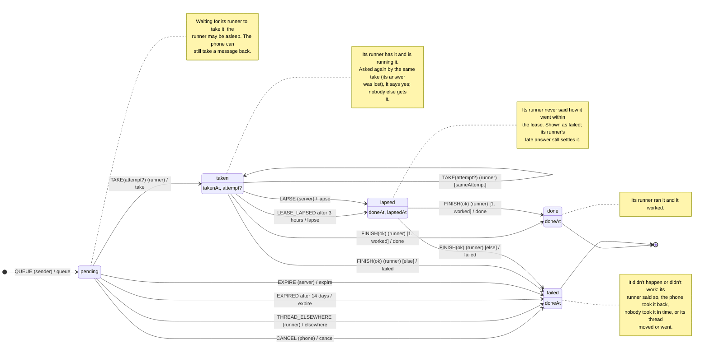

# The backend's state machines

Drawn from the rules the backend runs (`convex/machines.ts`), as the website's Machines page draws them, by `npm run machine-docs` in runner/: don't edit it by hand. docs/lifecycles.md says which lifecycles are machines so far, and which are next.

## command

Something the phone, the website or the main Mac asked a runner to do: it waits for its runner, which takes it once, runs it and says how it went.

How a row is born:

- `QUEUE (sender)` → `pending`. The phone, the website or the main Mac asks a runner to do something: a message, a new thread, a setting.

From `pending`:

- The clock sends `EXPIRED` after 14 days. Two weeks have passed and its runner never took it.
- `TAKE(attempt?) (runner)` → `taken`. Its runner takes it, once: any other take is refused.
- `CANCEL (phone)` → `failed`. The phone takes the message back before its runner has it.
- `THREAD_ELSEWHERE (runner)` → `failed`. Its thread moved to another runner or was deleted before it was taken, so this runner never runs it.
- `EXPIRED after 14 days` → `failed`. Nobody took it in two weeks.
- `EXPIRE (server)` → `failed`. The sweep finds it waiting past two weeks (rows from before timers).

From `taken`:

- The clock sends `LEASE_LAPSED` after 3 hours. Three hours have passed and its runner never said how it went: it stopped partway, or has been away too long.
- `TAKE(attempt?) (runner)` [sameAttempt] stays put. The same take asking again after its answer was lost: told yes, and nothing changes.
- `FINISH(ok) (runner)` [1. worked] → `done`. Its runner says it worked.
- `FINISH(ok) (runner)` [else] → `failed`. Its runner says it didn't work, and why.
- `LEASE_LAPSED after 3 hours` → `lapsed`. It lapses, shown as failed. It is never handed out again, as it may have run.
- `LAPSE (server)` → `lapsed`. The sweep finds it taken past its lease (rows from before timers).

From `lapsed`:

- `FINISH(ok) (runner)` [1. worked] → `done`. Its runner says it worked.
- `FINISH(ok) (runner)` [else] → `failed`. Its runner says it didn't work, and why.

## move

A thread moving from the runner that has it (S) to another (T): T says it can take it, S freezes and packs it sealed to T, and T unpacks and claims it. At any moment one runner has the thread.

How a row is born:

- `START (owner)` → `asking`. The main Mac starts a move, for Mike or an agent: to an online runner, one move per thread at a time.

From `asking`:

- The clock sends `NO_ANSWER` at askBy. Ten minutes have passed since the move started, or since S described the thread, and T hasn't said it can take it.
- `DESCRIBE(info) (runner)` stays put. S describes the thread once, and T's ten minutes start again.
- `READY(plan, sealKey) (runner)` [described] → `ready`. T says where it will put the thread and gives the key to seal it to.
- `CANCEL (owner)` → `cancelled`. Mike changes his mind.
- `FAIL(note) (runner)` → `failed`. S or T says it can't go on: the thread stays where it is.
- `NO_ANSWER at askBy` → `failed`. T didn't answer in time.

From `ready`:

- The clock sends `WAITED_TOO_LONG` at giveUpAt. Twelve hours have passed and S's thread is still busy.
- `FREEZE (runner)` → `packing`. S's thread has finished its turn and is frozen: packing starts.
- `CANCEL (owner)` → `cancelled`. Mike changes his mind.
- `FAIL(note) (runner)` → `failed`. S or T says it can't go on: the thread stays where it is.
- `SOURCE_GONE (server)` → `failed`. The sweep finds S has been offline ten minutes (asleep or switched off): the thread stays where it is.
- `WAITED_TOO_LONG at giveUpAt` → `failed`. The thread stays where it is.

From `packing`:

- The clock sends `TOO_SLOW` at giveUpAt. Thirty minutes have passed since S froze the thread.
- `PACK(chunks, sha256, bytes) (runner)` → `unpacking`. S has uploaded the sealed bundle: T's turn.
- `CANCEL (owner)` → `cancelled`. Mike changes his mind: S unfreezes the thread.
- `FAIL(note) (runner)` → `failed`. S or T says it can't go on: S unfreezes the thread.
- `TOO_SLOW at giveUpAt` → `failed`. The move is given up, so the thread isn't left frozen on S for good.

From `unpacking`:

- The clock sends `TOO_SLOW` at giveUpAt. Thirty minutes have passed since S froze the thread.
- `CLAIM (runner)` [1. stillOnSource] → `claimed`. The switch: from here the thread, its Pocket cards and its share link are T's, commands for it go to T, and its rows start going over.
- `CLAIM (runner)` [else] → `failed`. The thread isn't on S any more (deleted, or moved some other way), so there's nothing to take.
- `FAIL(note) (runner)` → `failed`. S or T says it can't go on: S unfreezes the thread.
- `TOO_SLOW at giveUpAt` → `failed`. The move is given up, so the thread isn't left frozen on S for good.

From `claimed`:

- `DONE (runner)` stays put. T says it's running the thread, before every row has gone over: it ends once they have.
- `REHOMED (server)` [1. doneAsked] → `done`. The last row has gone to T, which has already said it's running the thread.
- `REHOMED (server)` [else] → `handedOver`. The last row has gone to T, which hasn't said it's running the thread yet.

From `handedOver`:

- `DONE (runner)` → `done`. T says it's running the thread.
