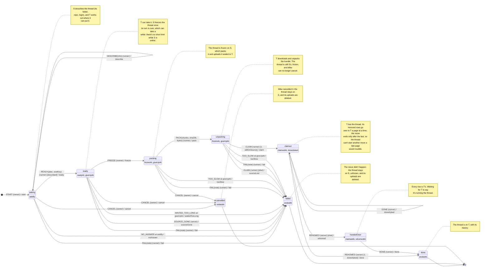
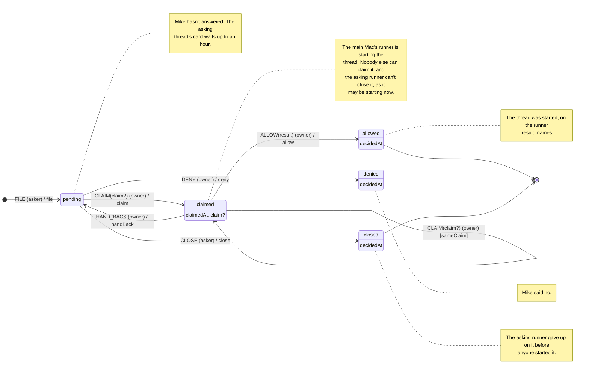
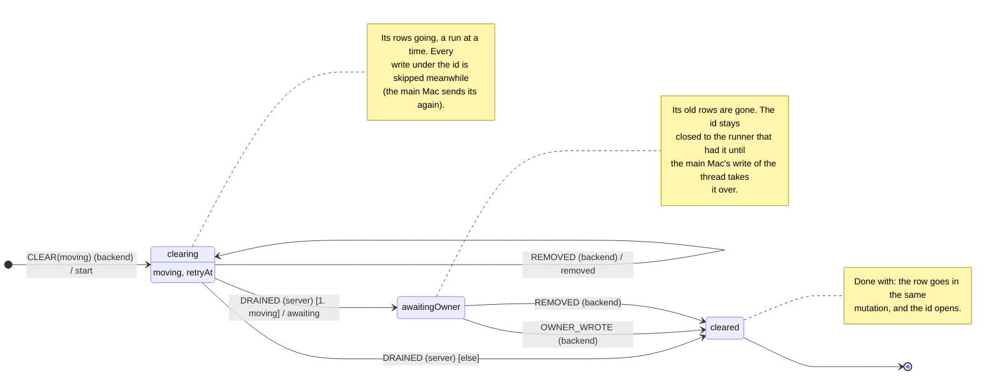

# The backend's state machines

Drawn from the rules the backend runs (`convex/machines.ts`), as the website's Machines page draws them, by `npm run machine-docs` in runner/: don't edit it by hand. docs/lifecycles.md says which lifecycles are machines so far, and which are next.

## command

Something the phone, the website or the main Mac asked a runner to do: it waits for its runner, which takes it once, runs it and says how it went.

How a row is born:

- `QUEUE (sender)` → `pending`. The phone, the website or the main Mac asks a runner to do something: a message, a new thread, a setting.

From `pending`:

- The clock sends `EXPIRED` after 14 days. Two weeks have passed and its runner never took it.
- `TAKE(attempt?) (runner)` → `taken`. Its runner takes it, once: any other take is refused.
- `CANCEL (phone)` → `failed`. The phone takes the message back before its runner has it.
- `THREAD_ELSEWHERE (runner)` → `failed`. Its thread moved to another runner or was deleted before it was taken, so this runner never runs it.
- `EXPIRED after 14 days` → `failed`. Nobody took it in two weeks.
- `EXPIRE (server)` → `failed`. The sweep finds it waiting past two weeks (rows from before timers).

From `taken`:

- The clock sends `LEASE_LAPSED` after 3 hours. Three hours have passed and its runner never said how it went: it stopped partway, or has been away too long.
- `TAKE(attempt?) (runner)` [sameAttempt] stays put. The same take asking again after its answer was lost: told yes, and nothing changes.
- `FINISH(ok) (runner)` [1. worked] → `done`. Its runner says it worked.
- `FINISH(ok) (runner)` [else] → `failed`. Its runner says it didn't work, and why.
- `LEASE_LAPSED after 3 hours` → `lapsed`. It lapses, shown as failed. It is never handed out again, as it may have run.
- `LAPSE (server)` → `lapsed`. The sweep finds it taken past its lease (rows from before timers).

From `lapsed`:

- `FINISH(ok) (runner)` [1. worked] → `done`. Its runner says it worked.
- `FINISH(ok) (runner)` [else] → `failed`. Its runner says it didn't work, and why.

## move

A thread moving from the runner that has it (S) to another (T): T says it can take it, S freezes and packs it sealed to T, and T unpacks and claims it. At any moment one runner has the thread.

How a row is born:

- `START (owner)` → `asking`. The main Mac starts a move, for Mike or an agent: to an online runner, one move per thread at a time.

From `asking`:

- The clock sends `NO_ANSWER` at askBy. Ten minutes have passed since the move started, or since S described the thread, and T hasn't said it can take it.
- `DESCRIBE(info) (runner)` stays put. S describes the thread once, and T's ten minutes start again.
- `READY(plan, sealKey) (runner)` [described] → `ready`. T says where it will put the thread and gives the key to seal it to.
- `CANCEL (owner)` → `cancelled`. Mike changes his mind.
- `FAIL(note) (runner)` → `failed`. S or T says it can't go on: the thread stays where it is.
- `NO_ANSWER at askBy` → `failed`. T didn't answer in time.

From `ready`:

- The clock sends `WAITED_TOO_LONG` at giveUpAt. Twelve hours have passed and S's thread is still busy.
- `FREEZE (runner)` → `packing`. S's thread has finished its turn and is frozen: packing starts.
- `CANCEL (owner)` → `cancelled`. Mike changes his mind.
- `FAIL(note) (runner)` → `failed`. S or T says it can't go on: the thread stays where it is.
- `SOURCE_GONE (server)` → `failed`. The sweep finds S has been offline ten minutes (asleep or switched off): the thread stays where it is.
- `WAITED_TOO_LONG at giveUpAt` → `failed`. The thread stays where it is.

From `packing`:

- The clock sends `TOO_SLOW` at giveUpAt. Thirty minutes have passed since S froze the thread.
- `PACK(chunks, sha256, bytes) (runner)` → `unpacking`. S has uploaded the sealed bundle: T's turn.
- `CANCEL (owner)` → `cancelled`. Mike changes his mind: S unfreezes the thread.
- `FAIL(note) (runner)` → `failed`. S or T says it can't go on: S unfreezes the thread.
- `TOO_SLOW at giveUpAt` → `failed`. The move is given up, so the thread isn't left frozen on S for good.

From `unpacking`:

- The clock sends `TOO_SLOW` at giveUpAt. Thirty minutes have passed since S froze the thread.
- `CLAIM (runner)` [1. stillOnSource] → `claimed`. The switch: from here the thread, its Pocket cards and its share link are T's, commands for it go to T, and its rows start going over.
- `CLAIM (runner)` [else] → `failed`. The thread isn't on S any more (deleted, or moved some other way), so there's nothing to take.
- `FAIL(note) (runner)` → `failed`. S or T says it can't go on: S unfreezes the thread.
- `TOO_SLOW at giveUpAt` → `failed`. The move is given up, so the thread isn't left frozen on S for good.

From `claimed`:

- `DONE (runner)` stays put. T says it's running the thread, before every row has gone over: it ends once they have.
- `REHOMED (server)` [1. doneAsked] → `done`. The last row has gone to T, which has already said it's running the thread.
- `REHOMED (server)` [else] → `handedOver`. The last row has gone to T, which hasn't said it's running the thread yet.

From `handedOver`:

- `DONE (runner)` → `done`. T says it's running the thread.

## request

A runner on a runner key asking for a new thread on another runner. It can't start one there itself, so Mike sees exactly what it asked for on the main Mac, whose runner starts it if he allows it.

How a row is born:

- `FILE (asker)` → `pending`. A runner files a request from one of its own threads, which shows a card for it there.

From `pending`:

- `CLAIM(claim?) (owner)` → `claimed`. Mike allowed it: the main Mac's runner claims it before starting the thread, so a retry or another click can't start a second.
- `DENY (owner)` → `denied`. Mike said no.
- `CLOSE (asker)` → `closed`. The asking runner gave up on it: its card expired, or was declined there. It stops counting against that runner's limit.

From `claimed`:

- `CLAIM(claim?) (owner)` [sameClaim] stays put. The same claim asking again after its answer was lost: told yes, and nothing changes.
- `ALLOW(result) (owner)` → `allowed`. The thread started: the request says where.
- `HAND_BACK (owner)` → `pending`. Starting it failed on the main Mac: it waits for Mike again, and the next claim is a new one.

## clear

A thread id's old rows going a run at a time, after the thread was removed or taken over by the main Mac. Nothing is written under the id until they've gone.

How a row is born:

- `CLEAR(moving) (backend)` → `clearing`. A thread removed, or taken over by the main Mac, with more rows than one mutation may read: the rest go in runs of their own.

From `clearing`:

- The clock sends `STALLED` at retryAt. Ten minutes with no run moving it on: a run threw, or was lost.
- `PROGRESS (server)` stays put. A run deleted what it could read; another follows, and the ten minutes start again.
- `STALLED at retryAt` stays put. The runs start again from where the rows are: each deletes what it reads.
- `REMOVED (backend)` stays put. The thread is removed while its rows go: no takeover to finish, so the id opens once they have.
- `DRAINED (server)` [1. moving] → `awaitingOwner`. All gone, for a takeover: the main Mac's next write of the thread goes through.
- `DRAINED (server)` [else] → `cleared`. All gone: the id opens again.

From `awaitingOwner`:

- `OWNER_WROTE (backend)` → `cleared`. The main Mac's write of the thread goes through: it's the main Mac's now.
- `REMOVED (backend)` → `cleared`. The thread is removed before the main Mac wrote it: the id opens.

## box

A thread's box on a virtual runner: made when the thread starts, saved and slept when it's idle, woken for a message (the same box resumed, or a new one from the save), and deleted when the thread is archived. Every box that runs the thread is the same runner, each on a key of its own.

```mermaid
stateDiagram-v2
  direction LR
  state "creating" as creating
  creating : bootBy
  note right of creating
The service is asking the provider for
the thread's first box.
  end note
  state "starting" as starting
  starting : bootBy
  note right of starting
The box is booting: its runner will
trade the boot token for its box key,
the login token and the thread key.
  end note
  state "awake" as awake
  awake : since, leaseUntil
  note right of awake
The box's runner is running the thread,
on its own box key, and heartbeats every
minute.
  end note
  state "saving" as saving
  saving : since, leaseUntil, saveBy
  note right of saving
The box is saving the thread out of
itself: committing and pushing its work,
and uploading the folder and transcript
sealed with the thread key.
  end note
  state "asleep" as asleep
  asleep : since
  note right of asleep
The thread is saved and its box paused
or deleted. Nothing is running; it costs
a paused box's disk at most.
  end note
  state "waking" as waking
  waking : bootBy
  note right of waking
The thread is coming back for a message:
its paused box resuming, or a new box
being made that restores the last save.
  end note
  state "destroying" as destroying
  destroying : since
  note right of destroying
The thread is archived: the provider is
deleting its box. No key works for it
any more.
  end note
  state "gone" as gone
  gone : at
  note right of gone
The box is deleted. The row stays for
its save, deleted after the virtual
runner's deleteAfterDays.
  end note
  state "failed" as failed
  failed : at, error
  note right of failed
A box couldn't be started or brought
back. The thread and its last save are
kept, and no key works for it.
  end note
  [*] --> creating : START (owner) / start
  creating --> starting : CREATED(providerBoxId, attempt?) (server) / created
  creating --> awake : READY (runner) / ready
  creating --> failed : FAILED(error) (server) / fail
  creating --> creating : LOST(attempt?) (server) / forgetOldBox
  creating --> failed : BOOT_TIMEOUT at bootBy / bootTimeout
  creating --> destroying : ARCHIVE (owner) / archive
  starting --> awake : READY (runner) / ready
  starting --> failed : FAILED(error) (server) / fail
  starting --> waking : LOST(attempt?) (server) [1. currentBox] / bootLost
  starting --> starting : LOST(attempt?) (server) [else] / forgetOldBox
  starting --> failed : BOOT_TIMEOUT at bootBy / bootTimeout
  starting --> destroying : ARCHIVE (owner) / archive
  awake --> awake : LEASE_DUE at leaseUntil [1. heardFrom] / renewLease
  awake --> waking : LEASE_DUE at leaseUntil [else] / lost
  awake --> waking : LOST(attempt?) (server) [1. currentBox] / lost
  awake --> awake : LOST(attempt?) (server) [else] / forgetOldBox
  awake --> saving : IDLE (server) / askSave
  awake --> awake : SAVED(storageId, bytes) (runner) / saved
  awake --> awake : CREATED(providerBoxId, attempt?) (server) / noteBox
  awake --> destroying : ARCHIVE (owner) / archive
  saving --> asleep : SAVED(storageId, bytes) (runner) / sleep
  saving --> awake : WAKE (server) / stayUp
  saving --> awake : SAVE_TIMEOUT at saveBy / stayUp
  saving --> saving : LEASE_DUE at leaseUntil [1. heardFrom] / renewLease
  saving --> waking : LEASE_DUE at leaseUntil [else] / lost
  saving --> waking : LOST(attempt?) (server) [1. currentBox] / lost
  saving --> saving : LOST(attempt?) (server) [else] / forgetOldBox
  saving --> destroying : ARCHIVE (owner) / archive
  asleep --> waking : WAKE (server) / wake
  asleep --> asleep : LOST(attempt?) (server) / forgetBox
  asleep --> destroying : ARCHIVE (owner) / archive
  waking --> awake : RESUMED (server) [hasKey] / resumed
  waking --> starting : CREATED(providerBoxId, attempt?) (server) / created
  waking --> waking : LOST(attempt?) (server) / forgetOldBox
  waking --> awake : READY (runner) / ready
  waking --> failed : FAILED(error) (server) / fail
  waking --> failed : BOOT_TIMEOUT at bootBy / bootTimeout
  waking --> destroying : ARCHIVE (owner) / archive
  destroying --> gone : DESTROYED (server) / destroyed
  failed --> waking : WAKE (server) / wake
  failed --> destroying : ARCHIVE (owner) / archive
  gone --> [*]
```

How a row is born:

- `START (owner)` → `creating`. A thread starts on a virtual runner: the service asks the provider for its first box, with a boot token and nothing reusable in its environment.

From `creating`:

- The clock sends `BOOT_TIMEOUT` at bootBy. Ten minutes have passed and no box has traded the thread's boot token for its key.
- `CREATED(providerBoxId, attempt?) (server)` → `starting`. The provider has made the box, which boots and starts its runner.
- `READY (runner)` → `awake`. The box booted and traded its boot token for its key before the provider's answer came back.
- `FAILED(error) (server)` → `failed`. The provider couldn't make a box.
- `LOST(attempt?) (server)` stays put. The provider lost the box it was making: the service makes another before the ten minutes are up.
- `BOOT_TIMEOUT at bootBy` → `failed`. No box checked in: the thread waits for the next message to try again.
- `ARCHIVE (owner)` → `destroying`. Mike archives the thread before its box is up.

From `starting`:

- The clock sends `BOOT_TIMEOUT` at bootBy. Ten minutes have passed since the box was asked for, and it hasn't traded its boot token.
- `READY (runner)` → `awake`. The box traded its boot token: its key is the only one for the thread from now on.
- `FAILED(error) (server)` → `failed`. The provider says the box didn't start.
- `LOST(attempt?) (server)` [1. currentBox] → `waking`. The box was lost while it booted: no key or boot token of it works, and a new box is made, restoring the last save if there is one.
- `LOST(attempt?) (server)` [else] stays put. An older box's loss, reported late: only what was that box's goes.
- `BOOT_TIMEOUT at bootBy` → `failed`. The box never checked in: the thread waits for the next message to try again.
- `ARCHIVE (owner)` → `destroying`. Mike archives the thread while its box boots.

From `awake`:

- The clock sends `LEASE_DUE` at leaseUntil. Five minutes since the lease was last renewed: the box must have heartbeated meanwhile.
- `LEASE_DUE at leaseUntil` [1. heardFrom] stays put. It has heartbeated: the lease runs five minutes from its last heartbeat.
- `LEASE_DUE at leaseUntil` [else] → `waking`. No heartbeat for five minutes: the box is lost. Its key is refused from now, and a new box restores the thread from its last save.
- `LOST(attempt?) (server)` [1. currentBox] → `waking`. The provider says the box is gone: its key is refused from now, and a new box restores the thread from its last save.
- `LOST(attempt?) (server)` [else] stays put. An older box's loss, reported late: only what was that box's goes.
- `IDLE (server)` → `saving`. The thread has been idle a while (or the box has been up its day's hours): the box is asked to save the thread before it sleeps.
- `SAVED(storageId, bytes) (runner)` stays put. The box saved the thread unasked: the save replaces the last one, and it stays awake.
- `CREATED(providerBoxId, attempt?) (server)` stays put. The provider's answer arrives after the box was already up: its id is kept, for pausing and deleting it.
- `ARCHIVE (owner)` → `destroying`. Mike archives the thread: its box is deleted.

From `saving`:

- The clock sends `LEASE_DUE` at leaseUntil. Five minutes since the lease was last renewed: the box must have heartbeated meanwhile.
- The clock sends `SAVE_TIMEOUT` at saveBy. Ten minutes have passed and the box hasn't said it saved.
- `SAVED(storageId, bytes) (runner)` → `asleep`. The save is in: it replaces the last one, and the box is paused if the provider can, else deleted.
- `WAKE (server)` → `awake`. A message came in while it saved: the box stays up.
- `SAVE_TIMEOUT at saveBy` → `awake`. No save came: the box stays up rather than lose work, and it's asked again at the next idle check.
- `LEASE_DUE at leaseUntil` [1. heardFrom] stays put. It has heartbeated: the lease runs five minutes from its last heartbeat.
- `LEASE_DUE at leaseUntil` [else] → `waking`. No heartbeat for five minutes: the box is lost, and a new box restores the thread from its last save.
- `LOST(attempt?) (server)` [1. currentBox] → `waking`. The provider says the box is gone mid-save: a new box restores the thread from its last save.
- `LOST(attempt?) (server)` [else] stays put. An older box's loss, reported late: only what was that box's goes.
- `ARCHIVE (owner)` → `destroying`. Mike archives the thread: its box is deleted.

From `asleep`:

- `WAKE (server)` → `waking`. A message for the thread: the paused box is resumed, or a new one restores the save. Once only: a second message while it's waking doesn't start another.
- `LOST(attempt?) (server)` stays put. The provider lost the paused box: its key goes with it, and as the save is still here, the next wake starts a new box.
- `ARCHIVE (owner)` → `destroying`. Mike archives the thread: its box, if any, is deleted.

From `waking`:

- The clock sends `BOOT_TIMEOUT` at bootBy. Ten minutes have passed and the box hasn't come back.
- `RESUMED (server)` [hasKey] → `awake`. The paused box resumed, its runner still holding its key.
- `CREATED(providerBoxId, attempt?) (server)` → `starting`. A new box was made: the last box's key stops working, and the new one boots, trades a fresh boot token, and restores the save.
- `LOST(attempt?) (server)` stays put. The paused box was lost before it resumed: its key stops working, and a new box restores the save instead.
- `READY (runner)` → `awake`. A new box traded its boot token: its key replaces the last box's, which is refused from now.
- `FAILED(error) (server)` → `failed`. The provider couldn't bring a box back.
- `BOOT_TIMEOUT at bootBy` → `failed`. No box came back: the thread waits for the next message to try again.
- `ARCHIVE (owner)` → `destroying`. Mike archives the thread while it wakes.

From `destroying`:

- `DESTROYED (server)` → `gone`. The provider has deleted the box.

From `failed`:

- `WAKE (server)` → `waking`. A new message tries again with a new box.
- `ARCHIVE (owner)` → `destroying`. Mike archives the thread: any box the provider still has is deleted.
